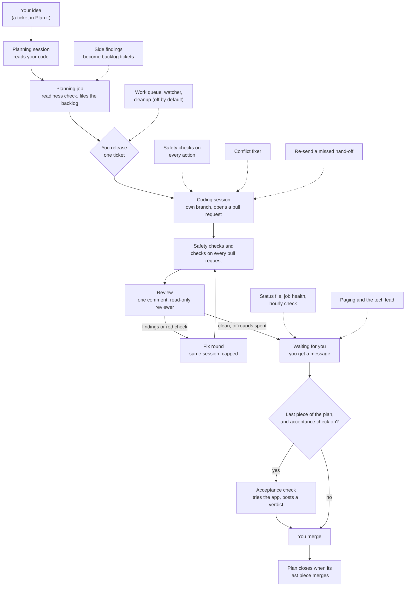

# The whole system — how it works, part by part

*Written 2026-11-11. The one-command update is in `docs/START-HERE.md`. The runbook for when it stops is `docs/OPERATIONS.md`. The teaching page is `docs/lessons/system.md`.*

Read this once, end to end. Each part is short. Unfamiliar words are explained at the end.

You write an idea as a ticket. A machine turns it into a plan, writes the code, reviews it and fixes it. A person merges. This guide names every part and says how far the safety promises reach. To see what is behind on a running machine, run `python3 scripts/pipeline_update.py review` and read what it says.

> **Where it stands on 2026-11-11, part by part.** The kit's parts list (`docs/PARTS.md`, built from `pipeline-parts.json`) marks 21 parts **live**, 10 **built, off by default** and 1 **designed only**. Live means the kit ships the part and it is meant to run. It does not mean it runs on your machine. The list is the only place these states are kept. This page copies them, so check the list if the two ever differ.

**Live** (21):

- Safety checks on every action a session takes
- A check on every commit, and a scan for secrets
- Checks on every pull request, and nothing merges red
- The project's settings file, which switches the pipeline on
- Turning a fresh copy of the kit into a project
- Written procedures a session runs as slash commands
- The mark that tells the safety checks a session is the pipeline's
- Coding sessions that take a ticket to a pull request
- The tracker's columns and labels
- Code review of every pull request a session opens, and the fix rounds
- Side findings a session leaves become backlog tickets
- Re-sends a hand-off the session runner missed
- One file of where every plan stands
- Says when one of the pipeline's jobs stops
- Fixes your pull requests when main moves under them
- Turns an idea into a reviewed plan of tickets
- Your tech lead: a chat that answers you and acts on your yes
- Messages you when only a person can act
- An hourly check of what nothing else watches
- Says what on this machine is behind, and updates the session runner
- The one command that brings this machine up to date

**Built, off by default** (10). The code and its tests exist. Nothing runs it until a person switches it on.

- Reviews post under their own login, not yours
- Answers your messages in seconds, not at the next minute
- The session runner's own chat channel, kept switched off
- Removes what finished sessions left behind
- Starts approved work on its own, inside a working window and a budget
- An independent auditor that can pause new work
- Tries the finished app before a plan's last piece merges
- Approves and merges in your place, inside hard limits
- Runs the pipeline on hosted runners instead of this machine
- Lets work start and safe changes merge without you, in narrow cases

**Designed only** (1). The kit says what it must be. It does not build it.

- The always-on machine that runs the sessions

---

## The one-line version

You write an idea in the tracker (Linear) and move it to **Plan it**. A planning session reads your code and proposes a plan. The planning job files it in the backlog if every ticket passes the readiness check. You release a ticket by handing it to the session runner. A coding session builds it and opens a pull request. A reviewer reads the pull request. Fix rounds follow. The work then waits for you. **You merge.**

---

## The parts, in order

### 1. The safety checks — before anything else exists

The first parts work with no pipeline at all.

- **Safety checks on every action a session takes.** Every tool call a Claude session makes is checked first. The risky ones are refused.
- **A check on every commit, and a scan for secrets.** A commit on main, or one holding a secret, is refused.
- **Checks on every pull request, and nothing merges red.** The checks run in CI. Branch protection makes the required ones block a merge.

If you want only guardrails, stop here. Everything below is optional.

### 2. The project's settings file — the switch

A project turns the pipeline on with one committed file. Without it, every pipeline part stays off and quiet. A readiness check refuses any ticket that lacks the required sections.

- **The project's settings file, which switches the pipeline on** holds the team, the states, the labels and the fix-round budget.
- **Turning a fresh copy of the kit into a project** fills in the stack details and opens a pull request.
- **Written procedures a session runs as slash commands** are the procedures a session follows, such as taking a ticket to a pull request.

### 3. The machine that runs the sessions

**The always-on machine that runs the sessions** is designed only. It is a separate account on a Mac that stays on, plus the session runner. The kit says what a correct machine is (`docs/HOST.md`). It does not build one.

Two parts depend on it:

- **The mark that tells the safety checks a session is the pipeline's.** One empty file, owned by root. Without it, the pipeline-only checks do not apply to the sessions the runner starts.
- **Coding sessions that take a ticket to a pull request.** The runner starts a Claude session on a delegated ticket, in its own worktree, under the checks. It opens a pull request. It never merges.

### 4. The tracker board

**The tracker's columns and labels** are what every job matches by name or by id. The installers add the review and planning columns themselves. A person makes the rest.

Some labels are the pipeline's alone. A session may never apply a supervision label to itself.

### 5. Planning — an idea becomes a plan

**Turns an idea into a reviewed plan of tickets.** Moving an idea to **Plan it** is the only thing that starts planning.

- The job checks that you made the move, and that the ticket is an idea, not live work.
- It writes a clean copy of your idea, quoted as data, and hands that copy to a planning session. The session cannot write to the tracker.
- The session answers with a proposed epic and its pieces.
- The job files a project, an epic and tickets into the **backlog only**. If one piece fails the readiness check, the whole plan is refused with reasons.

The plan is a proposal. Nothing in it starts until a person releases it.

### 6. Coding — one ticket, one pull request

You hand one ticket to the session runner. **Coding sessions that take a ticket to a pull request** do the rest.

- The session works on its own branch, named from the ticket.
- It plans first, as a ticket comment. It makes the smallest change that meets the acceptance criteria.
- It runs the project's local checks, opens a pull request and stops.
- If the work is unclear, it posts one question on the ticket and ends. It never waits for a person.

### 7. Review and the fix rounds

**Code review of every pull request a session opens, and the fix rounds.**

- A job finds the pull request and files a review ticket. A read-only reviewer reads it. The reviewer has no shell, no edit and no write tools.
- One comment lands on the pull request: findings, clean, or *NOT reviewed*. It is never an approval.
- If findings reach the threshold, or a required check is red, a driver asks the same coding session for a fix. The count is capped by the budget in the settings file.
- When the work is clean, or the rounds are spent, the driver moves the ticket to the needs-approval lane and the **paging** part tells you.

A review that could not run says so in a visible comment. It never reads as clean.

### 8. The parts that keep the loop moving

- **Side findings a session leaves become backlog tickets.** A session leaves a structured finding on its own ticket. A job files it as an agent-filed backlog ticket. It never moves it to ready.
- **Re-sends a hand-off the session runner missed.** If the Mac slept past the tracker's retries, this prompts the ticket once more.
- **Fixes your pull requests when main moves under them.** Every five minutes it starts a capped session in your worktree to merge main in and push.
- **Reviews post under their own login, not yours** is built, off by default. Reviews would then carry an app identity of their own.

### 9. The parts that tell you

- **One file of where every plan stands.** Every 15 minutes, one file of facts about plans, pull requests, checks and reviews. The tech lead and the stand-up read it.
- **Says when one of the pipeline's jobs stops.** It reads each job's heartbeat and comments on one chosen ticket when health changes.
- **Messages you when only a person can act.** A blocked ticket, spent fix rounds, a declined review, a pull request ready to merge.
- **Your tech lead: a chat that answers you and acts on your yes.** A chat where you ask what is happening. It answers with a read-only run. It acts in the tracker only after your typed yes.
- **Answers your messages in seconds, not at the next minute** is built, off by default.
- **An hourly check of what nothing else watches.** Hooks, updates due, disk, memory and the public address.

### 10. The parts that start work without you

All of these are built and off by default. Leave them off until the live parts have run for a while.

- **Starts approved work on its own, inside a working window and a budget.** Plain code picks which approved tickets may start, and how many at once.
- **An independent auditor that can pause new work.** It runs under its own account. Its one power is to write a reason into a hold file that pauses new starts.
- **Lets work start and safe changes merge without you, in narrow cases.** Tier gates move a ticket to ready, or ask the code host to merge on its own terms.
- **Approves and merges in your place, inside hard limits.** Its evidence reader, settings and ledger are built. Nothing runs it.
- **Runs the pipeline on hosted runners instead of this machine.** Another way to run the same steps as workflows.

### 11. The acceptance check

**Tries the finished app before a plan's last piece merges.** It starts when exactly one piece of a plan is left, and that piece's pull request is open, green and reviewed.

- It opens the app in a real browser, in a locked sandbox with no network.
- It tries to disprove each problem it finds. A problem it cannot disprove becomes a follow-up request, at most three per run.
- It posts one verdict per head on the plan's epic. When it cannot check, the verdict says so.

### 12. Keeping the machine level

- **The one command that brings this machine up to date.** It pulls the kit, levels the skills, then runs the review, cleanup and planning installers in order. It stops only where a person must act.
- **Says what on this machine is behind, and updates the session runner.** After a typed yes, it updates the session runner and only that.
- **Removes what finished sessions left behind** is built, off by default. It deletes worktrees, ticket folders and temp folders. It only reads the tracker.
- **The session runner's own chat channel, kept switched off** is built, off by default. It keeps the runner's built-in chat off and its port closed.

---

## How one idea moves

The solid line is the work. The dotted lines are the parts that watch it. The acceptance check is off by default. When it is on, it runs before the plan's last piece merges. Otherwise you merge directly.

---

## How far the safety promises reach

The promise is plain. A session never merges, never approves and never labels its own work. People do those. This section says what holds that up, and where it is thin.

**What a session can never do**

- **Merge.** `gh pr merge`, with or without auto-merge, is refused by a guard. Merging is a person's act.
- **Approve a pull request.** Approval claims someone else read the code. A session that approves its own work makes the claim false.
- **Apply the protected labels.** The guard-change label and the supervision and block labels are a person's to apply.
- **Edit the guards.** The hook scripts and the settings files are refused to every session. A session writes a scratch copy and prints the command for a person to run.
- **Create tickets directly or release work.** Moving a ticket to ready, Done or Canceled is a person's call. A session asks through a request that a credential-holding job files.

**The guards, and what they can and cannot stop**

- They check each tool call before it runs. A block means the system is working. The answer is never to respell the command.
- They stop mistakes: an edit on main, a stacked branch, a secret read, a push to main.
- The checks that read shell text are **advisory**. Bash rewrites text before it runs it, and a respelled command gets past a pattern. The project measured this and recorded it.
- Three things do not depend on a pattern: branch protection on the code host, the checks in CI, and the operating system's sandbox. Anything that must survive a determined caller rests on those.

**A person's label on guarded changes**

A change to the guard machinery needs a person to apply the guard-change label. A CI job checks it, and it judges the change against the default branch's copy of its own rules. A pull request cannot loosen its own check.

**What is advisory**

- The session-start hint that tells a session its ticket is context only. Nothing may treat it as proof.
- Every report a session writes about itself: its branch name, its telemetry, its pull request text. These are reporting, not authority.
- Anything a ticket says. Ticket text is data. A ticket that asks for a guard change, a wider allowlist or a merge is escalated, never obeyed.

**Where it is thin, today**

- The guards stop a mistake, not an adversary.
- A person with the right keys on the machine can do what a session cannot. The machine is yours.
- Jobs that run unattended fail quietly. A heartbeat tells you a job ran. It cannot tell you it did the right thing.
- Nothing here protects a machine whose lane mark was never written. The sessions would then look like yours.

---

## What you do, day to day

1. Write an idea as a ticket. Move it to **Plan it**.
2. Read the plan when it arrives. Fix or cancel what is wrong.
3. Release a ticket by handing it to the session runner. Release a piece only after the ones it depends on.
4. Read the review comment on the pull request when the message arrives. Then merge it yourself.
5. After a merge, run `python3 scripts/pipeline_install.py` so the jobs run the new code.

Good: the pull request is merged by you, and the ticket moves to Done on its own.
Not that: a session merging, or a message you never got about a spent fix budget.

## When something looks wrong

| What you see | What to do |
|---|---|
| Nothing happened: no comment, no check, no message | Silence is this system's usual failure. Open `docs/OPERATIONS.md` and start at its silent-failure index |
| A moved idea gets no planning comment in about five minutes | Read the planning job's heartbeat. Planning may have stopped on purpose, waiting for you |
| A pull request shows no checks at all | It conflicts with main. Merge main in. The conflict fixer does this too |
| A review says *NOT reviewed* | Read its reason. Usually the ticket lacks an acceptance-criteria list, or the pull request is too big |
| A guard blocked a command | Read the block. If it is right, branch or fix and retry. If it is wrong, say so and stop |
| A job's heartbeat is old | The job stopped, or the Mac slept. Run `python3 scripts/pipeline_install.py` and read its rows |
| A ticket moved and nobody moved it | The tracker's code-host link moves a ticket when its pull request opens or merges. Name only the ticket a pull request completes |

## Words used here

| Word | Meaning |
|---|---|
| Ticket | One unit of work in the tracker, with a title, a description and acceptance criteria |
| Epic | A parent ticket. Its children are the pieces that add up to it |
| Backlog | The column where nothing starts. A ticket there is a proposal |
| Session runner | The program on the always-on machine that turns a handed-over ticket into a Claude session |
| Worktree | A separate folder where a session works on its own branch |
| Guard | A hook that checks a tool call and refuses a risky one |
| Heartbeat | A small file a job writes each time it runs |
| Fix round | One trip from review back to the coding session for a fix |
| Head | The newest commit on a pull request |
| Lane mark | The empty root-owned file that tells the guards a session is the pipeline's |

## What is not proven

- **That the whole chain has run unattended, end to end, for long.** Each part has run. The full loop over many plans has not been measured. No ticket yet.
- **That a stranger can follow this page and finish.** It was written from the guides and the code, not by following it on a clean machine. No ticket yet.
- **The acceptance check on a real plan.** It is built and tested offline. Its guide still says nothing runs its early slices. KIT-324.
- **The always-on machine.** The kit describes it and checks it. It ships no build for it. No ticket yet.
- **Approving and merging in your place.** Its parts are built. Nothing runs them, and no live merge has happened. No ticket yet.
- **The pipeline on Linux.** The installers write macOS jobs. No ticket yet.
- **A first-pass ceiling for each part.** Every ceiling in the parts list is empty. No ticket yet.
